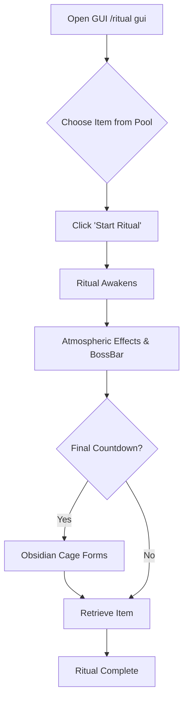
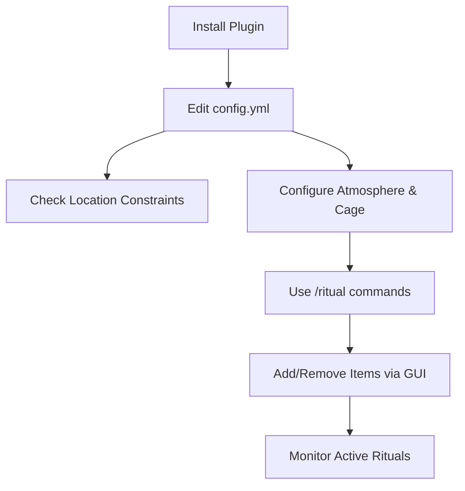

# ItemRituals Plugin

A Minecraft Bukkit/Paper plugin that adds mystical ritual events to your server. Players can select powerful items from a pool, start rituals that summon a reward item, and compete to collect it before time runs out.

## 🚀 Quick Start
1. **Download** the latest JAR.
2. **Install** to your `plugins/` folder.
3. **Restart** server and configure in `plugins/ItemRituals/config.yml`.

---

## 💎 Features
- **Ritual System**: Start rituals with items from a configurable pool.
- **Dynamic BossBar**: Track remaining time and ritual details in real-time.
- **Atmospheric Effects**: Immersive particles and sounds.
- **Obsidian Cage**: A sealed 30x30 magical barrier that auto-repairs.
- **Item Protection**: Prevent item theft, destruction, or despawning.
- **Location Randomization**: Automated safe-zone detection.


## 🗺️ How it Works

### ⚙️ Admin Flow

###  How To Use 


---


## 🛠️ Configuration
Edit `plugins/ItemRituals/config.yml` to customize:
- **Ritual Core**: Duration, radius, phase intervals.
- **Obsidian Cage**: Enabled state, size, warning time, material.
- **Atmosphere**: Particles and ambient sounds.
- **Protection**: Pickup, hopper, explosion, fire, and despawn prevention.

## 📜 Commands
| Command | Description |
| :--- | :--- |
| `/ritual` | Open the ritual item management GUI |
| `/ritual start` | Manually start a ritual |
| `/ritual stop` | Stop the current ritual |
| `/ritual reload` | Reload the plugin configuration |
| `//ritual status` | Check Location, Phase and Dimension |

## 🏗️ Building from Source
Requires Maven and Java 17+:
```bash
mvn clean package
```

---
*Built for PaperMC 1.20.4+*
